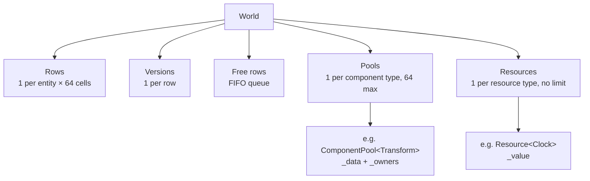

# ECS

The engine's data model is an ECS (Entity Component System). Components are
stored in packed pools, like a **sparse set**, and each entity has a **row**
that tells, for every component type, where its component is in the pool.

For why we chose this design, see [Design decisions](../decisions.md#ecs).

## Concepts

| Concept       | What it is                                                                     |
| ------------- | ------------------------------------------------------------------------------ |
| **Entity**    | A handle (`index` + `version`). It has no data or behaviour of its own.        |
| **Component** | A plain data struct (`Transform`, `Health`, `Sprite`…) attached to an entity.  |
| **Pool**      | The storage of one component type: all the `Transform`s together, packed.      |
| **World**     | Owns everything: entities, their rows, the pools and the resources.            |
| **System**    | Logic: a class with `update(World&)` that loops over entities.                 |
| **Resource**  | An object that exists once per world and belongs to no entity (clock, score…). |

Everything is in the `ampersand::core::ecs` namespace. Include
`<ampersand/core/ecs/World.hpp>` to use the ECS, and
`<ampersand/core/ecs/ECSExceptions.hpp>` to catch its errors.

## Example

```cpp
#include <ampersand/core/components/Transform.hpp>
#include <ampersand/core/ecs/World.hpp>
#include <ampersand/core/resources/Clock.hpp>
#include <ampersand/physics/components/Velocity.hpp>
#include <ampersand/physics/systems/MovementSystem.hpp>

namespace core = ampersand::core;
namespace ecs = ampersand::core::ecs;
namespace physics = ampersand::physics;

int main() {
    ecs::World world;  // 10 000 entities at most by default
    world.addResource<core::Clock>();  // a resource

    const ecs::Entity ship = world.create();  // an entity
    world.add(ship, core::Transform{});  // its components
    world.add(ship, physics::Velocity{.value = {120.0F, 0.0F}});

    physics::MovementSystem movement;  // a system
    while (running) {
        world.getResource<core::Clock>().dt = frameTime();
        movement.update(world);  // moves the ship
    }
}
```

The game adds its own components, resources and systems in the same way. The
ones given by the engine are described in their module, for example
[Physics](physics.md).

## Overview



| Part      | Member       | Type                                                          |
| --------- | ------------ | ------------------------------------------------------------- |
| Rows      | `_rows`      | `std::vector<std::array<std::uint32_t, kMaxComponents>>`      |
| Versions  | `_versions`  | `std::vector<std::uint32_t>`                                  |
| Free rows | `_free`      | `std::queue<std::uint32_t>`                                   |
| Pools     | `_pools`     | `std::array<std::unique_ptr<IComponentPool>, kMaxComponents>` |
| Resources | `_resources` | `std::vector<std::unique_ptr<IResource>>`                     |

## Entities

| Call         | Effect                                                      | Throws               |
| ------------ | ----------------------------------------------------------- | -------------------- |
| `create()`   | new entity, with no component                               | `EntityLimitReached` |
| `destroy(e)` | removes all its components, then frees its row              | `InvalidEntity`      |
| `alive(e)`   | `true` if the handle still designates a live entity         | never                |

### The handle

```cpp
struct Entity {
    std::uint32_t index{};    // row of the entity in the World
    std::uint32_t version{};  // version of that row when the entity was created
};
```

Rows are reused after a `destroy`, so an old handle could point to a new,
unrelated entity. The version prevents it: each row has a version that starts at
**1** and is **incremented on `destroy`**, and a handle is alive only if its
version is the current version of its row.

Example: a homing missile keeps the handle of its target.

| Step                              | Version of row 42 | Handles                                         |
| --------------------------------- | ----------------- | ----------------------------------------------- |
| An enemy is created in row 42     | 1                 | enemy = `{42, 1}`, stored by the missile        |
| The enemy is destroyed            | **2**             | `{42, 1}` is dead                               |
| A power-up is created in row 42   | 2                 | power-up = `{42, 2}`                            |
| The missile checks its target     | 2                 | `{42, 1}` ≠ `{42, 2}` → dead, not the power-up  |

The same check protects the network code from late packets (a `DESTROY 42`
arriving after a new entity took row 42).

!!! tip "The null entity"
    Versions start at 1, so `Entity{}` (`{0, 0}`) is never alive. Use it as
    "no entity", for example in a `Target` component that has no target yet.

### Free rows

A destroyed row goes to the back of a FIFO queue, and `create()` takes the row
that was freed the longest time ago (or a new row if the queue is empty). This
spreads the reuse over all the free rows, so short-lived entities (laser shots)
do not wear out the version of the same rows.

## Components

| Call                | Effect                                         | Throws                                    |
| ------------------- | ---------------------------------------------- | ----------------------------------------- |
| `add(e, component)` | attaches a component (its type is deduced)     | `InvalidEntity`, `ComponentAlreadyExists` |
| `get<T>(e)`         | reference to the component                     | `InvalidEntity`, `ComponentNotFound`      |
| `has<T>(e)`         | `true` if it has a `T` (`false` if it is dead) | never                                     |
| `remove<T>(e)`      | detaches the component                         | `InvalidEntity`, `ComponentNotFound`      |
| `owners<T>()`       | the entities that have a `T`                   | never                                     |

The API is **strict**: adding a component twice, reading or removing a missing
one, or using a dead entity throws. Check with `has` or `alive` when you are not
sure.

A component can be any type that can be moved (`std::string` or `std::vector`
members are fine). It is passed **by value** to `add`. Empty structs
(`struct Enemy {};`) work as tags.

### Rows

Each component type gets a number, its **column**, the first time it is used
(`componentId<T>()`: 0 for the first type, 1 for the next…). Each entity has a
row with one cell per column, holding **the position of its component in the
pool + 1**, or **0** if it has none.

With `Transform` as column 0 and `Velocity` as column 1:

```
Rows                                   ComponentPool<Transform>
           Transform  Velocity            _data   [ T0 | T1 | T3 ]
   row 0  [    1    ,    1    ]           _owners [ e0 | e1 | e3 ]
   row 1  [    2    ,    0    ]
   row 2  [    0    ,    0    ]        ComponentPool<Velocity>
   row 3  [    3    ,    2    ]           _data   [ V0 | V3 ]
                                          _owners [ e0 | e3 ]
```

- `has<Velocity>(e3)`: row 3, column 1 is `2`, not 0, so it has one.
- `get<Velocity>(e3)`: `_data[2 - 1]`, so `V3`.
- `has<Velocity>(e1)`: row 1, column 1 is `0`, so it has none.

The row plays the role of a signature (a cell that is not 0 is a set bit) and
also gives the position, so there is nothing else to keep in sync. Thanks to the
+ 1, a new row filled with zeros is an entity with no component.

### Removing a component

Pools never have holes: removing a component moves the **last** one into the
freed slot (swap-and-pop), then the World updates the row of the entity that
moved.

```
remove<Velocity>(e0)       (row 0, column 1 is 1, so position 0)

ComponentPool<Velocity>       _data [ V0 | V3 ]   _owners [ e0 | e3 ]
1. the last one moves to 0    _data [ V3 | V3 ]   _owners [ e3 | e3 ]
2. the last slot is removed   _data [ V3 ]        _owners [ e3 ]
3. the World updates the rows row 3, column 1: 2 → 1      row 0, column 1: 1 → 0
```

Pools only move data and say which entity moved. The World is the only one that
writes in the rows.

## Systems

A system inherits `ISystem` and implements `update(World&)`. The game creates
its systems once and calls `update` in its own loop, in the order it wants.
`owners<T>()` gives the entities that have a `T`, and the system checks the other
components it needs with `has`:

```cpp
class MovementSystem final : public ecs::ISystem {
public:
    void update(ecs::World& world) override {
        for (const ecs::Entity entity : world.owners<Velocity>()) {
            if (!world.has<ampersand::core::Transform>(entity)) {
                continue;
            }
            ...
        }
    }
};
```

A system that has to remember something between frames keeps it in its members.

Loop on the component that the **fewest** entities have (here, fewer entities
move than have a position), and check the others with `has`: each check is a
single read in the entity's row.

!!! warning "Changing a pool while looping on it"
    `owners<T>()` is the pool's own list, not a copy. Inside a loop on
    `owners<T>()`, do **not** `remove<T>`, `add<T>` or `destroy` an entity that
    has a `T`: the swap-and-pop moves the last entity into the current slot and
    the loop **skips** it, and an `add` can reallocate the list (**undefined
    behaviour**).

    Two safe ways to destroy entities in a system:

    === "After the loop"

        ```cpp
        std::vector<ecs::Entity> toDestroy;
        for (const ecs::Entity enemy : world.owners<Enemy>()) {
            if (world.get<Health>(enemy).points <= 0) {
                toDestroy.push_back(enemy);
            }
        }
        for (const ecs::Entity enemy : toDestroy) {
            world.destroy(enemy);
        }
        ```

    === "Backwards"

        ```cpp
        const auto& enemies = world.owners<Enemy>();
        for (std::size_t i = enemies.size(); i-- > 0;) {
            const ecs::Entity enemy = enemies[i];
            if (world.get<Health>(enemy).points <= 0) {
                world.destroy(enemy);  // only the current entity
            }
        }
        ```

        The entity moved into the current slot comes from the end of the list,
        so it was already visited.

## Resources

| Call                       | Effect                                                 | Throws                  |
| -------------------------- | ------------------------------------------------------ | ----------------------- |
| `addResource<T>(args...)`  | builds the `T` in the World and returns a reference    | `ResourceAlreadyExists` |
| `getResource<T>()`         | reference to the resource                              | `ResourceNotFound`      |
| `hasResource<T>()`         | `true` if the World has a `T`                          | never                   |
| `removeResource<T>()`      | destroys the resource                                  | `ResourceNotFound`      |

```cpp
auto& score = world.addResource<Score>();
score.value = 0;

void scoreSystem(ecs::World& world) {
    world.getResource<Score>().value += 10;
}
```

There is one instance per type and per world. The resource is built directly in
the World, so types that cannot be copied or moved (window, socket) work.

!!! note "Interfaces"
    Resources are found by their **exact type**: after
    `addResource<SfmlRenderer>(...)`, `getResource<IRenderer>()` does not find it.
    To share an object through an interface, add it as that type, for example
    `world.addResource<IRenderer*>(&renderer)`.

## Entities as keys

`Entity` can be used in standard containers:

| Container                                       | Uses                                       |
| ----------------------------------------------- | ------------------------------------------ |
| `std::unordered_map<Entity, …>`, `unordered_set` | `std::hash<Entity>` (hash of the index)   |
| `std::map<Entity, …>`, `std::set`, `std::sort`  | `<=>`: index, then version                 |

```cpp
std::unordered_set<ecs::Entity> alreadyHit;  // enemies hit by a piercing laser
```

Two versions of the same row have the same hash but are not equal, so an old
handle never finds the data of the new entity.

## Errors

Every exception derives from `ECSError`, so a server can catch errors per system,
log them and keep running.

| Exception                | When                                                               |
| ------------------------ | ------------------------------------------------------------------ |
| `InvalidEntity`          | dead, null or out-of-range entity (a double `destroy` included)    |
| `ComponentAlreadyExists` | `add` of a component the entity already has                        |
| `ComponentNotFound`      | `get` or `remove` of a component the entity does not have          |
| `EntityLimitReached`     | `create` when the world is full                                    |
| `ComponentLimitReached`  | first use of a 65th component type                                 |
| `ResourceAlreadyExists`  | `addResource` of a type the World already has                      |
| `ResourceNotFound`       | `getResource` or `removeResource` of a type the World does not have |

## Limits

| Rule              | Value                                                                                       |
| ----------------- | ------------------------------------------------------------------------------------------- |
| Component types   | 64 at most (`kMaxComponents` in `ECSConfig.hpp`)                                            |
| Entities          | 10 000 per world by default (`kDefaultMaxEntities`), or `World(maxEntities)`                |
| Memory            | rows and versions are reserved at construction (about 2.6 MB for 10 000 entities)           |
| Threads           | a World is used by **one thread**. Several worlds can run in different threads.            |
| Library           | component and resource numbers are global to the program, so the engine must be a **static** library |
| Events            | none: modules check the pools themselves (for example `owners<Networked>()`)                |
