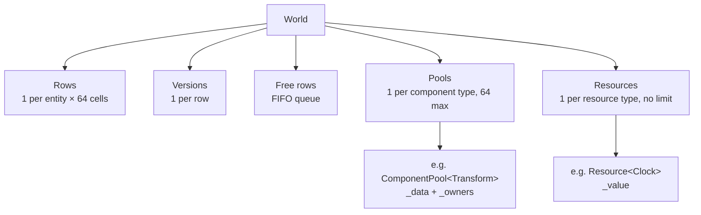

# ECS

The engine's data model is an ECS (Entity Component System). Components are
stored in packed pools, like a **sparse set**, and each entity has a **row**
that tells, for every component type, where its component is in the pool.

For why we chose this design, see [Design decisions](../decisions.md#ecs).

## Concepts

| Concept       | What it is                                                                     |
| ------------- | ------------------------------------------------------------------------------ |
| **Entity**    | A handle (`index` + `version`). It has no data or behaviour of its own.        |
| **Component** | A plain data struct (`Transform`, `Health`, `Sprite`…) attached to an entity.  |
| **Pool**      | The storage of one component type: all the `Transform`s together, packed.      |
| **World**     | Owns everything: entities, their rows, the pools and the resources.            |
| **System**    | Logic: a class with `update(World&)` that loops over entities.                 |
| **Scheduler** | Runs the systems in order, once per frame, and fills the `Clock`.              |
| **Event**     | A message sent by a system to the systems after it, in an `EventQueue`.        |
| **Command**   | A change to the World recorded by a system, applied at the end of the frame.   |
| **Resource**  | An object that exists once per world and belongs to no entity (clock, score…). |

Everything is in the `ampersand::core::ecs` namespace. Include
`<ampersand/core/ecs/World.hpp>` to use the ECS, and
`<ampersand/core/ecs/ECSExceptions.hpp>` to catch its errors.

## Example

```cpp
#include <ampersand/core/components/Transform.hpp>
#include <ampersand/core/ecs/Scheduler.hpp>
#include <ampersand/core/ecs/World.hpp>
#include <ampersand/core/time/FrameTimer.hpp>
#include <ampersand/physics/components/Velocity.hpp>
#include <ampersand/physics/systems/MovementSystem.hpp>

namespace core = ampersand::core;
namespace ecs = ampersand::core::ecs;
namespace physics = ampersand::physics;

int main() {
    ecs::World world;  // 10 000 entities at most by default

    const ecs::Entity ship = world.create();  // an entity
    world.add(ship, core::Transform{});  // its components
    world.add(ship, physics::Velocity{.value = {120.0F, 0.0F}});

    ecs::Scheduler scheduler(world);  // adds the Clock resource
    scheduler.add<physics::MovementSystem>();  // a system

    core::FrameTimer timer;  // a frame counts as 0.1 s at most
    while (running) {
        scheduler.update(timer.tick());  // moves the ship
    }
}
```

The game adds its own components, resources and systems in the same way. The
ones given by the engine are described in their module, for example
[Physics](physics.md).

## Storage



| Part      | Member       | Type                                                          |
| --------- | ------------ | ------------------------------------------------------------- |
| Rows      | `_rows`      | `std::vector<std::array<std::uint32_t, kMaxComponents>>`      |
| Versions  | `_versions`  | `std::vector<std::uint32_t>`                                  |
| Free rows | `_free`      | `std::queue<std::uint32_t>`                                   |
| Pools     | `_pools`     | `std::array<std::unique_ptr<IComponentPool>, kMaxComponents>` |
| Resources | `_resources` | `std::vector<std::unique_ptr<IResource>>`                     |

## Entities

| Call         | Effect                                                      | Throws               |
| ------------ | ----------------------------------------------------------- | -------------------- |
| `create()`   | new entity, with no component                               | `EntityLimitReached` |
| `destroy(e)` | removes all its components, then frees its row              | `InvalidEntity`      |
| `alive(e)`   | `true` if the handle still designates a live entity         | never                |

### The handle

```cpp
struct Entity {
    std::uint32_t index{};    // row of the entity in the World
    std::uint32_t version{};  // version of that row when the entity was created
};
```

Rows are reused after a `destroy`, so an old handle could point to a new,
unrelated entity. The version prevents it: each row has a version that starts at
**1** and is **incremented on `destroy`**, and a handle is alive only if its
version is the current version of its row.

Example: a homing missile keeps the handle of its target.

| Step                              | Version of row 42 | Handles                                         |
| --------------------------------- | ----------------- | ----------------------------------------------- |
| An enemy is created in row 42     | 1                 | enemy = `{42, 1}`, stored by the missile        |
| The enemy is destroyed            | **2**             | `{42, 1}` is dead                               |
| A power-up is created in row 42   | 2                 | power-up = `{42, 2}`                            |
| The missile checks its target     | 2                 | `{42, 1}` ≠ `{42, 2}` → dead, not the power-up  |

The same check protects the network code from late packets (a `DESTROY 42`
arriving after a new entity took row 42).

!!! tip "The null entity"
    Versions start at 1, so `Entity{}` (`{0, 0}`) is never alive. Use it as
    "no entity", for example in a `Target` component that has no target yet.

### Free rows

A destroyed row goes to the back of a FIFO queue, and `create()` takes the row
that was freed the longest time ago (or a new row if the queue is empty). This
spreads the reuse over all the free rows, so short-lived entities (laser shots)
do not wear out the version of the same rows.

## Components

| Call                | Effect                                         | Throws                                    |
| ------------------- | ---------------------------------------------- | ----------------------------------------- |
| `add(e, component)` | attaches a component (its type is deduced)     | `InvalidEntity`, `ComponentAlreadyExists` |
| `get<T>(e)`         | reference to the component                     | `InvalidEntity`, `ComponentNotFound`      |
| `has<T>(e)`         | `true` if it has a `T` (`false` if it is dead) | never                                     |
| `remove<T>(e)`      | detaches the component                         | `InvalidEntity`, `ComponentNotFound`      |
| `owners<T>()`       | the entities that have a `T`                   | never                                     |

The API is **strict**: adding a component twice, reading or removing a missing
one, or using a dead entity throws. Check with `has` or `alive` when you are not
sure.

A component can be any type that can be moved (`std::string` or `std::vector`
members are fine). It is passed **by value** to `add`. Empty structs
(`struct Enemy {};`) work as tags.

### Rows

Each component type gets a number, its **column**, the first time it is used
(`componentId<T>()`: 0 for the first type, 1 for the next…). Each entity has a
row with one cell per column, holding **the position of its component in the
pool + 1**, or **0** if it has none.

With `Transform` as column 0 and `Velocity` as column 1:

```
Rows                                   ComponentPool<Transform>
           Transform  Velocity            _data   [ T0 | T1 | T3 ]
   row 0  [    1    ,    1    ]           _owners [ e0 | e1 | e3 ]
   row 1  [    2    ,    0    ]
   row 2  [    0    ,    0    ]        ComponentPool<Velocity>
   row 3  [    3    ,    2    ]           _data   [ V0 | V3 ]
                                          _owners [ e0 | e3 ]
```

- `has<Velocity>(e3)`: row 3, column 1 is `2`, not 0, so it has one.
- `get<Velocity>(e3)`: `_data[2 - 1]`, so `V3`.
- `has<Velocity>(e1)`: row 1, column 1 is `0`, so it has none.

The row plays the role of a signature (a cell that is not 0 is a set bit) and
also gives the position, so there is nothing else to keep in sync. Thanks to the
+ 1, a new row filled with zeros is an entity with no component.

### Removing a component

Pools never have holes: removing a component moves the **last** one into the
freed slot (swap-and-pop), then the World updates the row of the entity that
moved.

```
remove<Velocity>(e0)       (row 0, column 1 is 1, so position 0)

ComponentPool<Velocity>       _data [ V0 | V3 ]   _owners [ e0 | e3 ]
1. the last one moves to 0    _data [ V3 | V3 ]   _owners [ e3 | e3 ]
2. the last slot is removed   _data [ V3 ]        _owners [ e3 ]
3. the World updates the rows row 3, column 1: 2 → 1      row 0, column 1: 1 → 0
```

Pools only move data and say which entity moved. The World is the only one that
writes in the rows.

## Systems

A system inherits `ISystem` and implements `update(World&)`. The game gives its
systems to a [Scheduler](#scheduler), or creates them and calls `update` itself.
`owners<T>()` gives the entities that have a `T`, and the system checks the other
components it needs with `has`:

```cpp
class MovementSystem final : public ecs::ISystem {
public:
    void update(ecs::World& world) override {
        for (const ecs::Entity entity : world.owners<Velocity>()) {
            if (!world.has<ampersand::core::Transform>(entity)) {
                continue;
            }
            ...
        }
    }
};
```

A system that has to remember something between frames keeps it in its members.

Loop on the component that the **fewest** entities have (here, fewer entities
move than have a position), and check the others with `has`: each check is a
single read in the entity's row.

!!! warning "Changing a pool while looping on it"
    `owners<T>()` is the pool's own list, not a copy. Inside a loop on
    `owners<T>()`, do **not** `remove<T>`, `add<T>` or `destroy` an entity that
    has a `T`: the swap-and-pop moves the last entity into the current slot and
    the loop **skips** it, and an `add` can reallocate the list (**undefined
    behaviour**).

    Three safe ways to destroy entities in a system:

    === "With the CommandQueue"

        ```cpp
        auto& commands = world.getResource<ecs::CommandQueue>();
        for (const ecs::Entity enemy : world.owners<Enemy>()) {
            if (world.get<Health>(enemy).points <= 0) {
                commands.destroy(enemy);  // destroyed at the end of the frame
            }
        }
        ```

        See [Command queue](#command-queue).

    === "After the loop"

        ```cpp
        std::vector<ecs::Entity> toDestroy;
        for (const ecs::Entity enemy : world.owners<Enemy>()) {
            if (world.get<Health>(enemy).points <= 0) {
                toDestroy.push_back(enemy);
            }
        }
        for (const ecs::Entity enemy : toDestroy) {
            world.destroy(enemy);
        }
        ```

    === "Backwards"

        ```cpp
        const auto& enemies = world.owners<Enemy>();
        for (std::size_t i = enemies.size(); i-- > 0;) {
            const ecs::Entity enemy = enemies[i];
            if (world.get<Health>(enemy).points <= 0) {
                world.destroy(enemy);  // only the current entity
            }
        }
        ```

        The entity moved into the current slot comes from the end of the list,
        so it was already visited.

## Scheduler

The `Scheduler` owns the systems and runs them **in the order they were added**,
once per frame. Before the systems, it sets the `Clock` resource: `dt` is the
time given to `update`, and `elapsed` grows by `dt`.

| Call                 | Effect                                                         | Throws                  |
| -------------------- | -------------------------------------------------------------- | ----------------------- |
| `Scheduler(world)`   | adds a `Clock` and a `CommandQueue` to the World if it has none | never                  |
| `add<T>(args...)`    | builds the system `T` after the others and returns a reference | what `T` throws         |
| `update(deltaTime)`  | sets the `Clock`, then runs every system in order              | `std::invalid_argument` if `deltaTime` is negative or not finite, and what the systems throw |

The order matters: a system sees what the systems before it did in the same
frame (move, then test the collisions, then apply the damage).

```cpp
ecs::Scheduler scheduler(world);  // the World must outlive the Scheduler
scheduler.add<input::InputSystem>(poll);
scheduler.add<physics::MovementSystem>();
scheduler.add<physics::CollisionSystem>();
scheduler.add<render::RenderSystem>();
```

The time comes from the game, so the same loop works on both sides:

=== "Client (real time)"

    ```cpp
    core::FrameTimer timer;
    while (world.getResource<render::Renderer>().isOpen) {
        scheduler.update(timer.tick());
    }
    ```

    `FrameTimer::tick()` returns the seconds since its previous call (0 the
    first time), at most the value given to its constructor (`kDefaultMaxDt`,
    0.1 s, if none). After a long frame (window moved, slow machine), the game
    slows down instead of jumping.

=== "Server (fixed step)"

    ```cpp
    constexpr float kTick = 1.0F / 60.0F;
    while (running) {
        scheduler.update(kTick);
        sleepUntilNextTick();
    }
    ```

    Every update moves the game by the same time, so the same inputs give the
    same result.

!!! warning
    Do not call `add` from a system: the list of systems would change while the
    Scheduler loops on it.

## Event queues

A system tells the others that something happened (an entity died, an entity
spawned) by sending an **event** in an `EventQueue<T>`. The game defines the
event type, the engine only gives the queue:

```cpp
struct Died {
    ecs::Entity entity;
};

scheduler.addEventQueue<Died>();  // an EventQueue<Died> resource, emptied each frame
scheduler.add<DamageSystem>();    // sends
scheduler.add<ScoreSystem>();     // reads

// in DamageSystem::update
world.getResource<ecs::EventQueue<Died>>().send({.entity = enemy});

// in ScoreSystem::update
for (const Died& died : world.getResource<ecs::EventQueue<Died>>().read()) {
    score += 100;
}
```

| Call                          | Effect                                                   | Throws                  |
| ----------------------------- | -------------------------------------------------------- | ----------------------- |
| `scheduler.addEventQueue<T>()` | adds the `EventQueue<T>` resource and returns it        | `ResourceAlreadyExists` |
| `send(event)`                 | adds the event after the others                          | never                   |
| `read()`                      | the events sent since the last clear, in order           | never                   |
| `clear()`                     | removes every event (the Scheduler does it)              | never                   |

An event lives **one frame**: the Scheduler empties the queues after the last
system. So:

- a system reads the events of the systems **before** it in the same frame;
- a system **before** the sender never reads its events: put the readers after
  the senders;
- an event sent between two frames (by the game, outside `update`) is read
  during the next frame;
- if a system throws, the frame stops and the queues are not emptied.

Without a Scheduler, add the resource with `world.addResource<ecs::EventQueue<T>>()`
and call `clear()` at the end of each frame.

## Command queue

A **command** is a change to the World (destroy an entity...) that a system
records in the `CommandQueue` resource instead of doing it at once. The
Scheduler adds the queue and applies its commands, in the order they were
recorded, at the end of each frame. So a system can change the World while it
loops over `owners<T>()`:

```cpp
// in DamageSystem::update
for (const ecs::Entity enemy : world.owners<Enemy>()) {
    if (world.get<Health>(enemy).points <= 0) {
        world.getResource<ecs::EventQueue<Died>>().send({.entity = enemy});
        world.getResource<ecs::CommandQueue>().destroy(enemy);
    }
}

// in ExplosionSystem::update, after DamageSystem: the entity can still be used
for (const Died& died : world.getResource<ecs::EventQueue<Died>>().read()) {
    spawnExplosion(world, world.get<ecs::Transform>(died.entity).position);
}
```

The event and the command work together: the event tells the other systems
what happened, the command does the change at the end of the frame.


| Call              | Effect                                                     | Throws |
| ----------------- | ---------------------------------------------------------- | ------ |
| `destroy(e)`      | records the destruction of `e`                             | never  |
| `apply(world)`    | runs the commands in order, then empties the queue         | never  |

`destroy` skips an entity that is already dead when the queue is applied, so
two systems can destroy the same entity in the same frame.

Every command follows the same rules:

- a command changes nothing until the end of the frame: the systems after the
  one that records it still see the World as it was (a destroyed entity is
  still alive, to read its position, add to the score...);
- at the end of a frame, the Scheduler applies the `CommandQueue`, **then**
  empties the event queues;
- a command recorded between two frames is applied at the end of the next one;
- if a system throws, the frame stops and the queue is not applied.

Without a Scheduler, add the resource with `world.addResource<ecs::CommandQueue>()`
and call `apply(world)` at the end of each frame.

## Resources

| Call                       | Effect                                                 | Throws                  |
| -------------------------- | ------------------------------------------------------ | ----------------------- |
| `addResource<T>(args...)`  | builds the `T` in the World and returns a reference    | `ResourceAlreadyExists` |
| `getResource<T>()`         | reference to the resource                              | `ResourceNotFound`      |
| `hasResource<T>()`         | `true` if the World has a `T`                          | never                   |
| `removeResource<T>()`      | destroys the resource                                  | `ResourceNotFound`      |

```cpp
auto& score = world.addResource<Score>();
score.value = 0;

void scoreSystem(ecs::World& world) {
    world.getResource<Score>().value += 10;
}
```

There is one instance per type and per world. The resource is built directly in
the World, so types that cannot be copied or moved (window, socket) work.

!!! note "Interfaces"
    Resources are found by their **exact type**: after
    `addResource<SfmlAudioEngine>(...)`, `getResource<IAudioEngine>()` throws
    `ResourceNotFound`. To share an object through its interface, put a
    reference to the interface in a resource (see`AudioListener` ([Audio](audio.md)) and
    `Renderer` ([Render](render.md#window))).

## Entities as keys

`Entity` can be used in standard containers:

| Container                                       | Uses                                       |
| ----------------------------------------------- | ------------------------------------------ |
| `std::unordered_map<Entity, …>`, `unordered_set` | `std::hash<Entity>` (hash of the index)   |
| `std::map<Entity, …>`, `std::set`, `std::sort`  | `<=>`: index, then version                 |

```cpp
std::unordered_set<ecs::Entity> alreadyHit;  // enemies hit by a piercing laser
```

Two versions of the same row have the same hash but are not equal, so an old
handle never finds the data of the new entity.

## Errors

Every exception derives from `ECSError`, so a server can catch errors per system,
log them and keep running.

| Exception                | When                                                               |
| ------------------------ | ------------------------------------------------------------------ |
| `InvalidEntity`          | dead, null or out-of-range entity (a double `destroy` included)    |
| `ComponentAlreadyExists` | `add` of a component the entity already has                        |
| `ComponentNotFound`      | `get` or `remove` of a component the entity does not have          |
| `EntityLimitReached`     | `create` when the world is full                                    |
| `ComponentLimitReached`  | first use of a 65th component type                                 |
| `ResourceAlreadyExists`  | `addResource` of a type the World already has                      |
| `ResourceNotFound`       | `getResource` or `removeResource` of a type the World does not have |

## Limits

| Rule              | Value                                                                                       |
| ----------------- | ------------------------------------------------------------------------------------------- |
| Component types   | 64 at most (`kMaxComponents` in `ECSConfig.hpp`)                                            |
| Entities          | 10 000 per world by default (`kDefaultMaxEntities`), or `World(maxEntities)`                |
| Memory            | rows and versions are reserved at construction (about 2.6 MB for 10 000 entities)           |
| Threads           | a World is used by **one thread**. Several worlds can run in different threads.            |
| Library           | component and resource numbers are global to the program, so the engine must be a **static** library |
