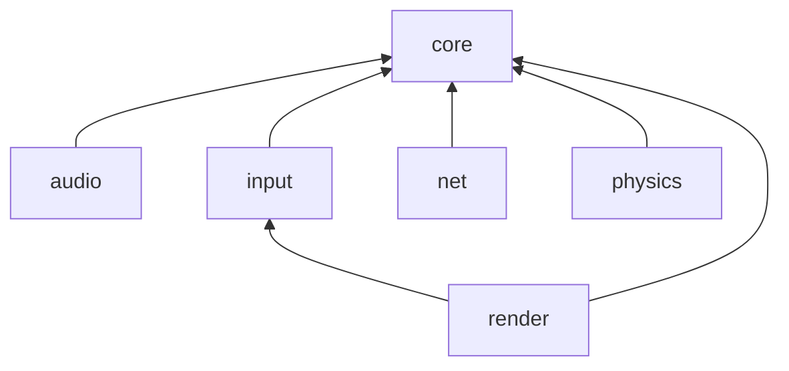

# Architecture

This section describes how the engine is organised.
For the reasons behind these choices, see [Design decisions](../decisions.md).

## Overview

The engine has two layers:

- **The ECS** (Entity Component System), in `core`, is the data model of the
  engine. Game objects are entities, their data lives in components, and the
  logic lives in systems. See [ECS](ecs.md).
- **The modules** add the features, each as its own library built on top of
  `core`. See [Modules](modules.md).

Every module works the same way: it gives **components** and **resources**
(plain data) and the **systems** that use them.

| Module                  | What it does                                                        |
| ----------------------- | ------------------------------------------------------------------- |
| [Physics](physics.md)   | moves the entities, makes them fall, finds the ones that touch      |
| [Render](render.md)     | draws the entities with a `Sprite` or a `Text`, plays their animations, handles the camera |
| [Input](input.md)       | keyboard and mouse events of the frame, what is held, where the mouse is |
| [Audio](audio.md)       | plays the sounds and music of the entities and of the scene         |
| [Net](net.md)           | sends and receives UDP datagrams, without knowing the game protocol |

## Module dependencies

`core` depends on no other module. `render` also depends on `input`, because
the events of its window include the keyboard and mouse events of `input`.
