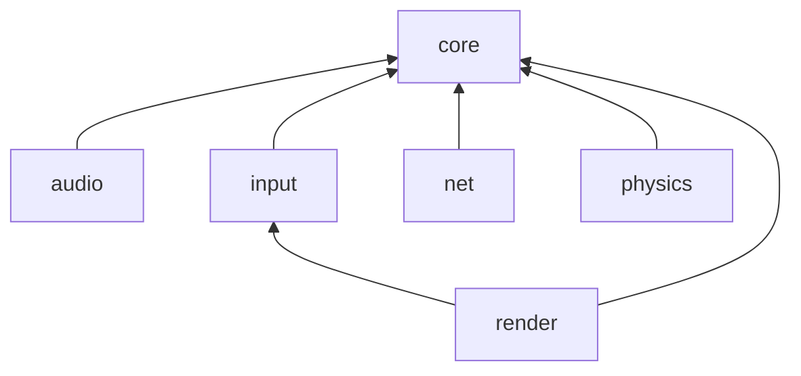

# Architecture

This section describes how the engine is organised.
For the reasons behind these choices, see [Design decisions](../decisions.md).

## Overview

The engine is made of two layers:

- **The ECS** (Entity Component System) is the engine's core data model. Game objects are entities, their data lives in components, and the logic lives in systems. See [ECS](ecs.md).
- **The modules** split the engine's features into separate libraries. Every module is built on top of `core`. See [Modules](modules.md).
- **Physics** moves entities, makes them fall and finds the ones that touch. See [Physics](physics.md).
- **Render** draws the entities with a `Sprite` or a `Text`, plays their animations and handles the camera. See [Render](rendering.md).
- **Audio** provides sound effects and music through an SFML-backed engine, with an `AudioSource` component and an `AudioSystem` driving them. See [Audio](audio.md).

## Module dependencies

`core` has no dependency on the other modules. The render module also depends on
input because its window event stream includes keyboard events.
